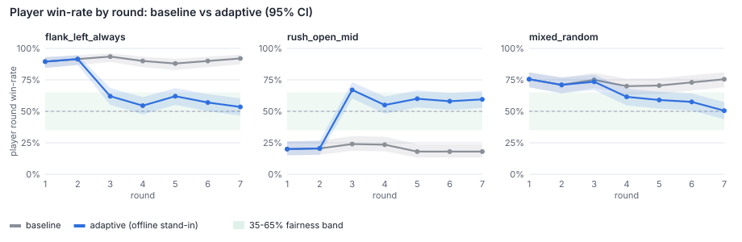

# VALOR: proof that the agent system works on a second, unrelated game

**Claim:** we took an existing shooter, described it once in `setup`, and the same agent system made its enemies adapt to how the player plays: watching the flank they keep winning from, and adding cover where they keep dying in the open. A self-check runs every change through a simulation first and refuses the ones that are invalid or unfair.

All numbers below come from `npx tsx scripts/proof/run.ts` (seeded, reproducible; raw data in `docs/proof/results.json`, `results.csv`, `selfcheck_log.json`, `latency.json`).

> **Read this first.** The adaptive arm measured here is the **offline stand-in** (`src/agent/standin.ts`). It is deterministic habit counting, **not Gemini**. The Gemini backend (`agents/`, owned by Felix and Gavin) was not available locally. The harness has a `--live` arm that runs the same matches through `ws://localhost:8000/ws`. It was skipped cleanly here (`results.json → live_gemini.skipped`). What this page proves:
> 1. The game-side contract works end to end: `setup → events → round_end → strategy_update → self-check → pick()`.
> 2. Adapting from these exact events beats the baseline by large, significant margins.
> 3. The self-check catches bad and unfair outputs.
>
> It does not yet prove anything about Gemini's own quality on VALOR.

## 1. What VALOR told the agents (the whole integration)

`src/agent/setup.ts → valorSetup()` is the only thing the agent side learns about VALOR. Nothing on the agent side is VALOR-specific. It contains:

- **about / goal:** a 3v3 round-based FPS on one plaza with three lanes. The goal is to *"take away what the player relies on, one habit at a time; when the player keeps dying in open ground, give them cover instead; keep them winning about half the rounds."*
- **npcs.red.decisions:** `position` (hold_mid, watch_left_flank, watch_right_flank, push_forward, hold_cover), `target` (nearest, player_first, weakest), `style` (stand_and_shoot, strafe_and_shoot, retreat_to_cover). Each has one plain line, and the names are exactly those in `src/agent/brain.ts`.
- **events:** `round_start` (with `picked`), `player_lane_change {lane}`, `shot`, `kill`, `death`, `died_in_open {lane, nearest_cover_m}`.
- **facts:** `player_zone`, `player_in_open`, `allies_alive`, `opponents_alive`, `round`, `enemy_index`.
- **views.game:** the player's screen as a 384 px JPEG at ~1 Hz. The description tells the model what is visible: lane, open paving vs pressed against cover, peeking round the bus, enemies on screen, health.
- **settings:** `enemy_accuracy` 0.15–0.7, `enemy_reaction_sec` 0.4–1.6, `enemy_damage` 6–20, and `cover`, a list of up to 4 of 11 named spots on the plaza (`lists.cover_spot`).
- **default_behaviour:** the baseline. It makes the same choices as `baselineBrain` (all three hold mid), and a unit test checks that.

Real frames of what Gemini would see are in `docs/proof/frames/game_{1,2,3}.jpg` (captured from the running game, ~9.6 KB each).

## 2. Method

- **Simulator** (`src/agent/sim.ts`): a headless 3v3 on the same plaza. Spawns, red posts per option, ally holds and the permanent cover are **imported from `src/game/teamAI.ts`**, not copied. Bot shots use the game's model: accuracy × distance falloff (45 m) × target-moving 0.45 × self-moving 0.8, reaction delay, 0.7–1.25 s between shots, 34 m range, ×1.5 damage bot-vs-bot. Red accuracy, reaction and damage come from `Brain.getSettings()`. Every red choice goes through `Brain.decide()` → `pick()`, the same call `teamAI.planRound()` makes. Line of sight is lane-based (see LIMITATIONS).
- **Scripted players:** `flank_left_always`, `rush_open_mid` (sprints to the enemy line through open ground), and `mixed_random` (random lane, cover 50%, rush 30%).
- **Arms:** (A) the baseline brain. (B) adaptive: stand-in → self-check → adaptive brain, with the behaviour swapped only between rounds. (C) live Gemini, which needs `--live` and a running backend.
- **N = 200 matches per habit per arm, 7 rounds each.** Match index *i* uses the same seed in both arms (common random numbers), so round 1 is identical by construction, and a test checks that. Match result = first to 4 rounds. 95% CIs: Wilson for rates, normal for means.

## 3. Results



| Scripted player | Arm | Player round win-rate (all 7) | Rounds 4–7 | Player match win-rate | Died in the open (per round) |
| --- | --- | --- | --- | --- | --- |
| flank_left_always | baseline | 90.6% [89.0–92.1] | 90.0% [87.7–91.9] | 100% [98.1–100] | 9.6% |
| flank_left_always | adaptive (stand-in) | **67.1%** [64.6–69.5] | **56.8%** [53.3–60.1] | 84.5% [78.8–88.9] | 40.4% |
| rush_open_mid | baseline | 20.3% [18.3–22.5] | 19.4% [16.8–22.3] | 3.0% [1.4–6.4] | 97.4% |
| rush_open_mid | adaptive (stand-in) | **48.6%** [46.0–51.2] | **58.1%** [54.7–61.5] | 50.5% [43.6–57.4] | **30.1%** |
| mixed_random | baseline | 72.9% [70.5–75.2] | 72.3% [69.0–75.2] | 87.0% [81.6–91.0] | 26.2% |
| mixed_random | adaptive (stand-in) | 64.1% [61.5–66.5] | 57.1% [53.7–60.5] | 77.0% [70.7–82.3] | 26.5% |

Win-rate by round (%, rounds 1→7):

| | baseline | adaptive |
| --- | --- | --- |
| flank_left_always | 90 92 94 90 88 90 92 | 90 92 **62 55 62 57 54** |
| rush_open_mid | 20 21 24 24 18 18 18 | 20 21 **67 55 60 58 60** |
| mixed_random | 76 71 75 70 71 73 76 | 76 71 74 62 59 57 51 |

- **The enemy adapts across rounds.** Both curves are the same for rounds 1–2, because the stand-in needs 2 rounds of evidence. They split at round 3 and stay inside or near the 35–65% band after that. The baseline stays flat.
- **Rounds until the counter appears:** flank_left → watch_left_flank was active by round **3.16** on average [3.10–3.21], in 97% of matches. rush_open_mid → mid cover was active by round **3.17** [3.11–3.22], in 100% of matches.
- **Deaths in the open, before vs after cover** (rush_open_mid): **97.5%** of rounds without mid cover vs **0.0%** of rounds with it ([0–0.4%]). By round: 98 97 → 14 2 0 0 0. See `proof/open_deaths_by_round.svg`.
- **Time-to-kill** (enemy TTK on the player, first enemy hit → death, mean seconds): flank_left 29.3 → 18.9 (the watchers now win the duel). rush_open_mid 12.6 → 17.4 (cover makes the player harder to kill).

## 4. What changed between rounds: a real `strategy_update`

From `results.json → examples.flank_left_always` (seed 1). The player won rounds 1–2 from the left. After round 2 the stand-in proposed (trimmed to the changed parts):

```json
{
  "type": "strategy_update", "version": 2, "source": "quick",
  "observations": ["Won 2 of the last 2 rounds by going up the left."],
  "plan": ["All three enemies watch the left flank."],
  "changes": [
    {"where": "red.rules", "from": null, "to": "If enemy_index in [0,1,2], position = watch_left_flank.", "why": "Won 2 of the last 2 rounds via the left flank."},
    {"where": "red.position.watch_left_flank", "from": {"base": 0}, "to": {"base": 0, "when": {"flanks_left": 1}}, "why": "Won 2 of the last 2 rounds via the left flank."}
  ],
  "behaviour": {"version": 2, "npcs": {"red": {"rules": [{"if": [{"fact": "enemy_index", "in": [0,1,2]}], "do": {"position": "watch_left_flank"}, "why": "Won 2 of the last 2 rounds via the left flank."}], "decisions": {"position": {"hold_mid": {"base": 1}, "watch_left_flank": {"base": 0, "when": {"flanks_left": 1}}, "...": "..."}}}}}
}
```

**Reason → act → verify, as it happened in that match:**

| After round | Candidate (strongest first) | Self-check | Predicted player win-rate |
| --- | --- | --- | --- |
| 2 | all three watch left | **accepted** | 62% |
| 3 | all three watch left | rejected: outside band | 77% |
| 3 | two watch left | **accepted** | 53% |
| 4 | three watch + cover incl. `left_wall_mid` | rejected (structure): *"left_wall_mid would block the left lane (4.2 m of cover at z≈-19 leaves < 1.5 m to walk through)"* | – |
| 4 | two watch + 2 crates | rejected: *"worse at countering … 45% vs 50% now"* | 45% |
| 5 | cover `left_crate_far + left_crate_mid` (player now dies in the open on the left) | **accepted** | 52% |

rush_open_mid, seed 1. The player died in the open in mid in rounds 1–2. The wall candidate was rejected: *"mid_wall_front overlaps a permanent block at (12, -18.2)"* and *"would block the mid lane"*. Two pieces of cover were rejected: *"82% outside the 35–65% band (now 18%)"*. The accepted candidate was *"mild: one crate (`mid_crate_front`) + enemy accuracy +0.05"*, predicted 60%. The player won round 3.

## 5. The self-check (the plan every output is checked against)

`src/agent/selfcheck.ts`. It runs on every candidate, from the stand-in or from Gemini, before anything is applied:

1. **Structure.** NPC, decision and option names must exist in `setup`. `when` values must be known. Rule facts must be declared. There can be at most 4 rules. Numeric settings must be within bounds. Cover must be named spots only, at most 4, ≥3 m from every spawn, not overlapping a permanent block, and never leaving a lane less than 1.5 m to walk through.
2. **Fairness.** It simulates the next round (60 sims per brain, common random numbers) with the candidate vs the current behaviour, against a player model fitted to the observed habits. It rejects a candidate if the predicted player win-rate leaves 35–65%, or if the candidate is further from 50% than the current behaviour (worse at countering the habit).

**In the N=200 run:** 4,489 candidates were checked and **2,530 rejected**: **946 on structure** and **1,584 on fairness**. Most common reasons:

| Count | Reason (real, from `selfcheck_log.json`) |
| --- | --- |
| 1,121 | worse at countering the habit than the current behaviour (predicted win-rate further from 50%) |
| 515 | `mid_wall_front` overlaps the permanent centre wall / would block the mid lane |
| 463 | predicted player win-rate outside the 35–65% fairness band |
| 431 | `left_wall_mid` + `left_crate_mid` would block the left lane |

**Injected faults** (clearly labelled: hand-written examples of what a model might hallucinate, run through the same validator):

| Fault | Rejection |
| --- | --- |
| invented option `snipe_from_roof` | `unknown option "red.position.snipe_from_roof"` |
| rule on undeclared fact | `rule uses unknown fact "player_health"` |
| enemy_accuracy 0.95 | `settings.enemy_accuracy = 0.95 is outside 0.15–0.7` |
| cover on the blue spawn | `"blue_spawn_crate" is not one of the allowed spots` |
| wall across mid | overlaps the permanent block; would block the mid lane |
| 5 cover objects / 5 rules | at most 4 |

## 6. Speed, reasoning, multimodality: what is measured

| Measurement | p50 | p95 | Source |
| --- | --- | --- | --- |
| stand-in: event → player_read | 0.003 ms | 0.015 ms | harness, n=11,508 |
| stand-in: round_end → decision, incl. self-check | 132 ms | 481 ms | harness, n=4,200 |
| self-check per candidate (60 sims × 2 brains) | 132 ms | 512 ms | harness |
| Gemini Neon: event → player_read | *not measured* | | `--live` slot ready |
| Gemini: round_end → quick / full update | *not measured* | | `--live` slot ready |
| `game` frame size (384 px JPEG q0.6) | ~9.6 KB | | 3 real captures |

- **The game never blocks on the agents.** Sends are fire-and-forget. Updates are applied only when the round is not live. The self-check runs in a `setTimeout` after `round_end`, during the 3.5 s banner. In-browser numbers (including frame-capture cost and the game-side cost per bridge call) come from `__valorAgent.report()` in the dev console. They were **not** collected on a real GPU for this page. The headless software-GL capture took ~2 s per frame, which is SwiftShader rendering, not representative.
- **Reasoning:** the agent side gets only §1. Section 4 shows the observation → plan → change → why chain, and the simulator verifying it.
- **Multimodality:** `hugs_cover` and `peeks_bus_side` are declared as pixel-only values. The stand-in cannot compute them (they stay 0), so any adaptation on them has to come from Gemini reading the frames. That is not yet demonstrated.

## 7. Where it fails

See `docs/LIMITATIONS.md` for the numbers. In short:
- It reacts to noise: a *random* player triggered a "habit" counter in 89.5% of matches.
- The flank counter moves the player's deaths into the open (9.6% → 55% of rounds with the counter on).
- Round 3 overshoots for rush_open_mid (67%, above the band) despite a 60% prediction.
- The fairness check itself is noisy (60 sims ≈ ±12%).
- The simulator is an abstraction with tuned human aim.
- No Gemini numbers yet.

## Reproduce

```
npx vitest run src/agent                    # 15 unit tests: pick(), self-check, stand-in, sim
npx tsx scripts/proof/run.ts                # N=200 (~13 min); --n 20 for a quick look
npx tsx scripts/proof/run.ts --live         # + live Gemini arm when the backend is up
node scripts/proof/capture-frames.mjs URL   # real 384 px frames (dev server running; CHANNEL=chrome)
```
